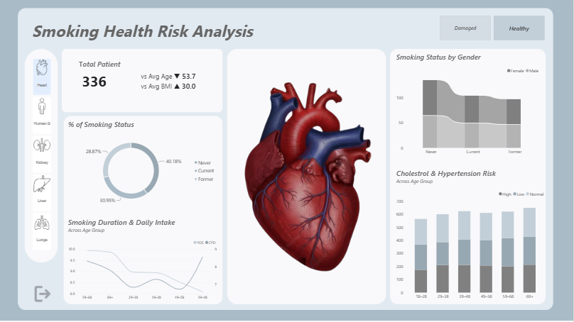
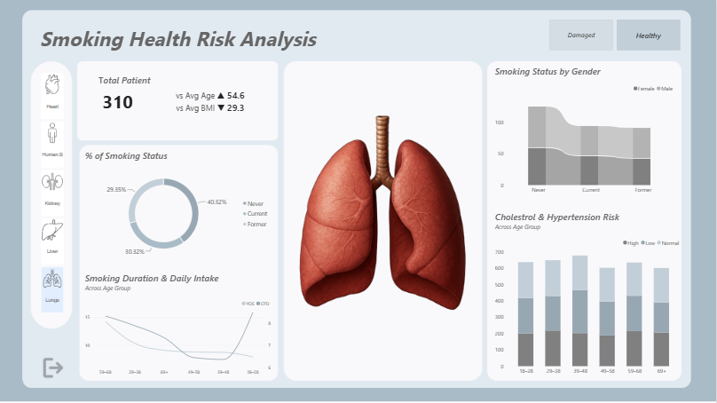
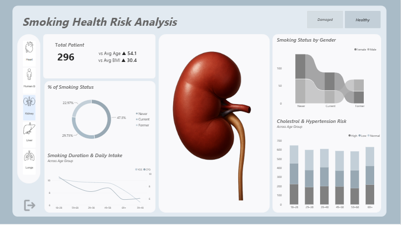
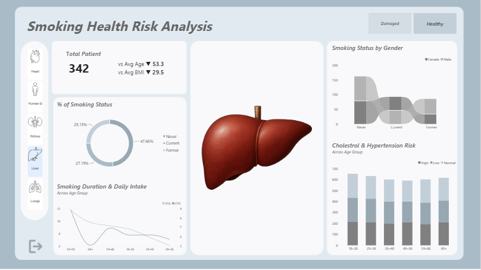
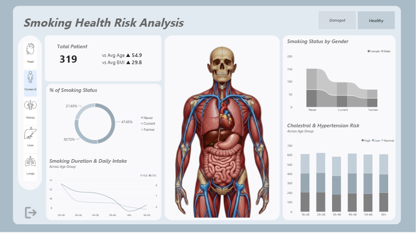
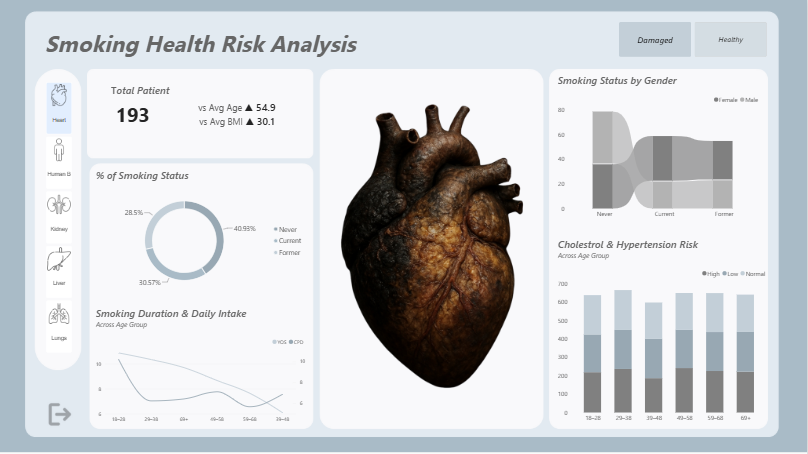
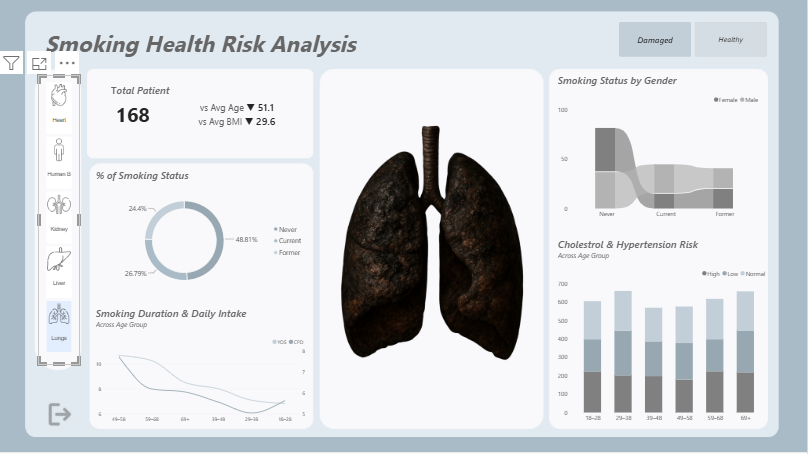
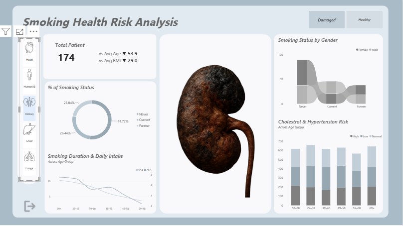
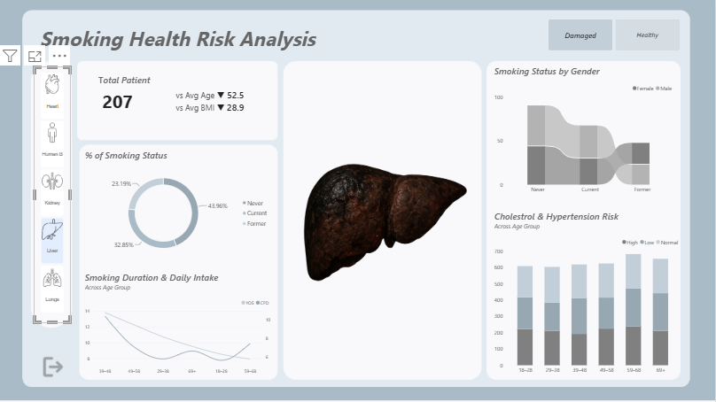
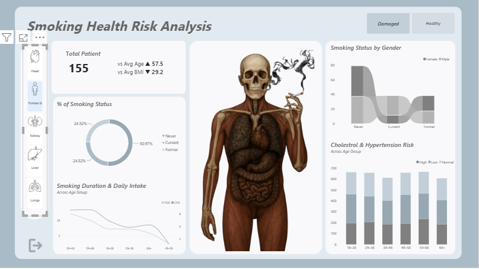

# Healthcare Data Analytics Dashboard — Power BI

An end-to-end health data analytics project built in Power BI: importing and cleaning the data, building a data model, writing DAX measures, and designing an interactive dashboard on smoking and health risk.

## Dashboard Preview

Users pick an organ (Heart, Human Body, Kidney, Liver, Lungs) and toggle **Healthy / Damaged**. The organ image, KPIs and all charts update with each selection.

### Healthy organs

| Heart | Lungs |
|---|---|
|  |  |

| Kidney | Liver |
|---|---|
|  |  |

| Human Body |
|---|
|  |

### Damaged organs

| Heart | Lungs |
|---|---|
|  |  |

| Kidney | Liver |
|---|---|
|  |  |

| Human Body |
|---|
|  |

### Total patients by selection

| Organ | Healthy | Damaged |
|---|---|---|
| Heart | 336 | 193 |
| Human Body | 319 | 155 |
| Kidney | 296 | 174 |
| Liver | 342 | 207 |
| Lungs | 310 | 168 |

## What I Learned

**Data preparation & modelling**
- Importing a healthcare dataset into Power BI and understanding its fields and structure.
- Cleaning and transforming data in Power Query before analysis.
- Building a structured data model with lookup tables (`condition`, `Organs`, `Image Dataset`) that keep slicers clean and cross-filtering predictable.

**DAX & measures**
- Writing patient-focused measures such as Total Patients, `vs Avg Age` and `vs Avg BMI`, with ▲/▼ indicators.
- Using a calculated column (`Age Group`) to combine demographics like age and gender with health insights.
- Adding dynamic titles that change with the user's selection.

**Dashboard design & interactivity**
- Adding a background image and rounded card layout for a clean, professional look.
- Creating KPI cards and button slicers for interactive filtering.
- Importing and configuring a custom **Chiclet Slicer** from a `.pbiviz` file (Visualizations pane → "…" → Import a visual from a file) for the Healthy / Damaged toggle.
- Using an image slicer so the central organ visual changes with the selection, showing healthy and damaged versions of each organ.

**Choosing the right visual**
- **Donut chart:** share of Never / Current / Former smokers.
- **Ribbon chart:** smoking status compared across gender.
- **Stacked bar chart:** cholesterol and blood-pressure risk across age groups.
- **Line chart:** years of smoking vs cigarettes per day across age groups.

**Storytelling & portfolio**
- Presenting health risk analysis visually so patterns in patient behaviour are easy to spot.
- Placing filters on the edges and insights in the centre so users can explore without clutter.
- Packaging the project for GitHub so it works as a portfolio piece.

## Credits

Built by following this tutorial: [Healthcare Data Analytics Dashboard in Power BI](https://www.youtube.com/watch?v=OgDq5GfUVrk&list=PLTrZQU5-tBf5z4Uq2YiS9DJnYgbJNkujp&index=2)
